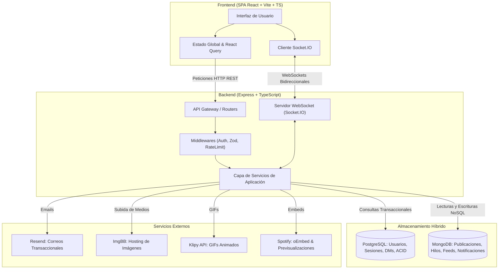
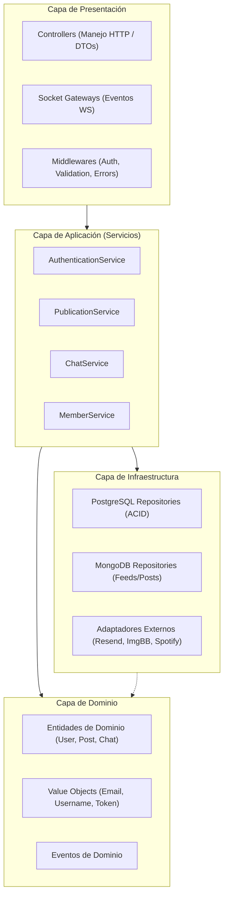

# Oomfy 🚀

> **Oomfy** es una red social y plataforma de microblogging en tiempo real inspirada en Twitter / X, diseñada para conectar personas mediante publicaciones dinámicas ("oomfs"), hilos de conversación, contenido multimedia enriquecido, interacciones sociales y mensajería directa instantánea.

---

## 📑 Tabla de Contenidos

1. [Visión General del Proyecto](#-visión-general-del-proyecto)
2. [Cómo Funciona la Plataforma](#-cómo-funciona-la-plataforma)
3. [Arquitectura del Sistema](#-arquitectura-del-sistema)
4. [Diagnóstico y Deuda Técnica Detectada](#-diagnóstico-y-deuda-técnica-detectada)
5. [Estrategia de Refactorización y Tecnologías](#-estrategia-de-refactorización-y-tecnologías)
6. [Patrones de Diseño y Principios de Ingeniería](#-patrones-de-diseño-y-principios-de-ingeniería)
7. [Estructura del Proyecto (Monorepo PNPM)](#-estructura-del-proyecto-monorepo-pnpm)
8. [Variables de Entorno y Configuración](#-variables-de-entorno-y-configuración)
9. [Bases de Datos y Migraciones](#-bases-de-datos-y-migraciones)
10. [Instalación y Puesta en Marcha](#-instalación-y-puesta-en-marcha)
11. [Estrategia de Testing](#-estrategia-de-testing)
12. [Hoja de Ruta (Roadmap)](#-hoja-de-ruta-roadmap)

---

## 🌟 Visión General del Proyecto

Oomfy permite a los usuarios compartir pensamientos, participar en debates mediante hilos anidados, reaccionar a publicaciones, subir medios visuales y chatear privadamente de forma instantánea.

### Características Principales
- 💬 **Timeline y Microblogging:** Publicaciones de texto (hasta 500 caracteres), imágenes múltiples (hasta 4) con visor interactivo (zoom in/out y arrastre táctil/mouse), GIFs animados integrados (Klipy API) y previsualización automática de enlaces externos e internos (citas al estilo Twitter / X).
- 🧵 **Hilos Jerárquicos y Citas:** Conversaciones anidadas organizadas con referencias a publicaciones raíz (`root`), padre (`parent`) y citas con comentarios (`quotes`).
- ❤️ **Interacciones Sociales:** Upvotes atómicos, retweets/republicaciones directas con persistencia y reconocimiento del estado de interacción por usuario, y seguimiento mutuo con métricas en tiempo real.
- 👤 **Perfiles de Usuario:** Biografías, ubicaciones, enlaces personales, avatares recortados y banners de perfil personalizables mediante modal retro pixel.
- 🔔 **Notificaciones en Vivo:** Alertas en tiempo real sobre likes, respuestas, menciones y nuevos seguidores vía WebSockets.
- ✉️ **Mensajería Directa Privada (DM):** Chats uno a uno con mensajería instantánea, estados de entrega y control de frecuencia (rate limiting).
- 🔍 **Exploración y Búsqueda Avanzada:** Pestañas de publicaciones y usuarios con filtros de contenido, autor, rango de fechas y multimedia.
- 📱 **Mobile-First & Botón Flotante:** Experiencia optimizada para smartphones con barra de navegación inferior, modal de publicación rápida y botón flotante de acción rápida.
- 🔐 **Seguridad y Control de Sesiones:** Autenticación JWT con Refresh Tokens en cookies `HttpOnly`, activación por correo mediante **Resend**, auditoría de sesiones activas por IP/dispositivo y protección reCAPTCHA v3.

---

## ⚙️ Cómo Funciona la Plataforma



1. **Carga y Autenticación:** El cliente carga la SPA y valida su sesión mediante un par de tokens (Access Token de 15 min y Refresh Token de 30 días persistido en cookies seguras). Si requiere activación, se envía un correo firmado mediante **Resend**.
2. **Navegación e Interacción:** El usuario consume el timeline obtenido mediante paginación basada en cursor desde MongoDB. Al crear un post con imágenes, estas se envían a ImgBB y se guardan junto con los metadatos en MongoDB.
3. **Tiempo Real:** Se establece un canal WebSocket con Socket.IO para recibir notificaciones instantáneas de interacciones (upvotes, respuestas) y mensajes de chat privado.

---

## 🏗️ Arquitectura del Sistema

El sistema adopta una **Arquitectura en Capas (Layers Pattern de POSA)** combinada con patrones empresariales de **PEAA (Martin Fowler)** y patrones de diseño de **GoF**:



---

## 🔍 Diagnóstico y Deuda Técnica Detectada

Una revisión exhaustiva del código existente reveló los siguientes puntos críticos que fundamentan la necesidad de rehacer el proyecto:

| Categoría | Problema Detectado | Impacto en el Sistema | Solución en la Refactorización |
|---|---|---|---|
| **Base de Datos** | Migración incompleta entre Postgres y Mongo (IDs enteros vs. UUIDs v7). | Errores 500 al dar upvote, borrar publicaciones o compartir posts de Mongo. | Unificar esquema con UUID v7; delimitar Postgres para usuarios/sesiones y Mongo para publicaciones/grafo social. |
| **Integridad de Datos** | El registro (`Signup`/`Verify`) no inserta el usuario en Mongo `members`. | Fallo inmediato en `Signin` (`Cannot read properties of null`). | Creación transaccional u orquestada de perfiles en ambas bases de datos con rollback. |
| **Conexiones DB** | Uso simultáneo y duplicado de `postgres` y `pg.Pool`. | Fugas de conexiones y falta de transacciones unificadas. | Unificar bajo una única capa de acceso con pool tipado y transacciones seguras. |
| **Migraciones** | Scripts manuales en `scripts/*.ts` sin control de versiones. | Imposibilidad de reproducir el estado de la base de datos de manera determinista. | Sistema de migraciones formales versionadas y reversibles (`up` y `down`). |
| **Frontend** | Monolito de JavaScript Vanilla con DOM manual y `window.app` global. | Código frágil, difícil de escalar, sin tipado y propenso a memory leaks. | Migración a React + Vite + TypeScript con componentes modulares y React Query. |
| **Acoplamiento** | Express sirve estáticos en `/public` y captura rutas con `sendFile`. | Imposibilidad de desplegar frontend y backend por separado. | Separar en Monorepo (`apps/api` y `apps/web`) con despliegue independiente. |
| **Código y SOLID** | Clases y archivos de 200 a 600 líneas (ej. `memberRepository.ts` con 621 líneas). | Violación de SRP, alta complejidad ciclomática y baja legibilidad. | Modularizar estrictamente en clases de **aproximadamente 100 líneas máximo**. |
| **Seguridad** | `Authorization.Everyone` exige JWT válido (no permite invitados). | Endpoints de consulta pública bloqueados para usuarios sin autenticar. | Separar guards: `Public`, `OptionalAuth`, `RequireAuth`, `RequireRoles`. |
| **Testing** | 0 pruebas unitarias, de integración o end-to-end. | Cero fiabilidad ante refactorizaciones y cambios de lógica. | Implementar suite completa con Vitest, React Testing Library y Supertest (>80% cobertura). |

---

## 🚀 Estrategia de Refactorización y Tecnologías

### Stack Tecnológico Objetivo
- **Gestor de Paquetes:** **PNPM** (Monorepo Workspaces).
- **Lenguaje:** **TypeScript** estricto en front, back y paquetes compartidos.
- **Frontend (`apps/web`):**
  - **Vite** + **React** (Componentes funcionales, Hooks tipados).
  - **Tailwind CSS** para estilizado moderno y modular.
  - **TanStack Query (React Query)** para caché del servidor y gestión de datos asíncronos.
  - **Zustand** para estado global liviano de autenticación y UI.
  - **Socket.IO Client** para tiempo real.
- **Backend (`apps/api`):**
  - **Node.js** + **Express** modularizado en clases controladoras.
  - **Socket.IO** para orquestación de WebSockets bidireccionales.
  - **PostgreSQL** para datos transaccionales, usuarios, sesiones y mensajería.
  - **MongoDB** para publicaciones, hilos, medios y grafo social.
  - **Resend** para envío confiable de correos transaccionales.
  - **Zod** para validación de esquemas en tiempo de compilación y ejecución.
- **Paquete Compartido (`packages/shared`):**
  - Contratos DTO, tipos de dominio y esquemas Zod reutilizados en web y api.
- **Testing:**
  - **Vitest** (Unitario e Integración en front y back).
  - **Supertest** (Integración de endpoints HTTP).
  - **React Testing Library** (Componentes de interfaz).

---

## 📐 Patrones de Diseño y Principios de Ingeniería

1. **PEAA (Patterns of Enterprise Application Architecture):**
   - **Repository:** Aislamiento total de las operaciones de base de datos.
   - **Service Layer:** Centralización de la lógica del negocio sin dependencias de Express (`req`, `res`).
   - **Data Mapper / DTOs:** Mapeo de registros de base de datos a modelos y respuestas públicas limpias.
   - **Unit of Work:** Manejo consistente de transacciones atómicas en PostgreSQL.
2. **GoF (Gang of Four):**
   - **Factory Method:** Creación estructurada de respuestas estandarizadas y adaptadores.
   - **Observer:** Manejo de eventos del sistema y emisión hacia clientes Socket.IO.
   - **Strategy:** Variantes para procesamiento de archivos multimedia y validaciones.
   - **Adapter:** Envolturas desacopladas para Resend, ImgBB, Spotify y Tenor.
3. **POSAD / POSA (Pattern-Oriented Software Architecture):**
   - **Layers:** Separación estricta entre Presentación, Aplicación, Dominio e Infraestructura.
   - **Broker:** Intermediario de mensajes para sincronizar eventos en tiempo real entre sesiones.
4. **Principios SOLID:**
   - **SRP (Single Responsibility):** Cada clase tiene un único motivo de cambio.
   - **Límite de 100 Líneas:** Ningún archivo debe exceder ~100 líneas de código para garantizar máxima legibilidad, facilidad de testing y alta cohesión.

---

## 📁 Estructura del Proyecto (Monorepo PNPM)

```
oomfy/
├── apps/
│   ├── api/                      # Backend Express + Socket.IO + TS
│   │   ├── src/
│   │   │   ├── config/           # Configuraciones y variables de entorno
│   │   │   ├── controllers/      # Clases controladoras (HTTP / Express)
│   │   │   ├── domain/           # Entidades, Value Objects y tipos de negocio
│   │   │   ├── infrastructure/   # Repositorios, clientes DB y adaptadores externos
│   │   │   ├── middlewares/      # Guards de auth, validación y errores
│   │   │   ├── routes/           # Rutas organizadas por módulo
│   │   │   ├── services/         # Servicios de casos de uso (Application layer)
│   │   │   ├── socket/           # Controladores de eventos Socket.IO
│   │   │   ├── Server.ts         # Servidor encapsulado en clase
│   │   │   └── index.ts          # Punto de entrada
│   │   ├── tests/                # Tests unitarios e integración
│   │   ├── package.json
│   │   └── tsconfig.json
│   │
│   └── web/                      # Frontend React + Vite + TS
│       ├── src/
│       │   ├── components/       # Componentes visuales organizados por dominio
│       │   ├── hooks/            # Custom hooks para lógica y consumo de APIs
│       │   ├── layouts/          # Layouts principales
│       │   ├── services/         # Clientes de API y WebSockets
│       │   ├── views/            # Páginas/vistas de la aplicación
│       │   ├── App.tsx
│       │   └── main.tsx
│       ├── tests/                # Tests de componentes y hooks
│       ├── package.json
│       └── vite.config.ts
│
├── packages/
│   └── shared/                   # DTOs, interfaces y esquemas Zod compartidos
│       ├── src/
│       ├── package.json
│       └── tsconfig.json
│
├── pnpm-workspace.yaml           # Configuración de workspaces
├── package.json                  # Scripts globales de desarrollo y test
├── REQUERIMIENTOS.md             # Especificación técnica detallada
└── README.md                     # Este archivo
```

---

## 🔐 Variables de Entorno y Configuración

Copia el archivo `.env.example` en la raíz (y en `apps/api`) y completa los siguientes parámetros:

```env
# Entorno y Red
NODE_ENV=development
PORT=4000
FRONTEND_URL=http://localhost:5173
# En producción:
# FRONTEND_URL=https://oomfy.online
# BACKEND_URL=https://api-oomfy.onrender.com

# Seguridad y Criptografía
JWT_SECRET=tu_clave_secreta_jwt_muy_segura
JWT_REFRESH_SECRET=tu_clave_secreta_refresh_token

# Base de Datos PostgreSQL
PG_HOST=localhost
PG_PORT=5432
PG_DATABASE=oomfy
PG_USER=postgres
PG_PASSWORD=tu_contraseña
PG_SSL=false

# Base de Datos MongoDB
MONGODB_URI=mongodb://localhost:27017/oomfy
MONGODB_DB_NAME=oomfy

# Servicios Externos
RESEND_API_KEY=re_123456789
IMGBB_KEY=tu_api_key_imgbb
TENOR_KEY=tu_api_key_tenor
RECAPTCHA_SECRET_KEY=tu_secret_key_recaptcha
```

---

## 🗄️ Bases de Datos y Migraciones

El proyecto cuenta con un sistema de migraciones automatizadas para garantizar que los cambios de esquema sean incrementales, seguros y reproducibles:

```bash
# Ejecutar migraciones de PostgreSQL
pnpm --filter @oomfy/api migrate:pg:up

# Revertir última migración de PostgreSQL
pnpm --filter @oomfy/api migrate:pg:down

# Ejecutar migraciones de MongoDB
pnpm --filter @oomfy/api migrate:mongo:up
```

---

## 💻 Instalación y Puesta en Marcha

### Prerrequisitos
- **Node.js** v20 LTS o superior
- **PNPM** v9 o superior (`npm install -g pnpm`)
- Instancias accesibles de **PostgreSQL** y **MongoDB**

### Pasos de Instalación

```bash
# 1. Clonar el repositorio
git clone <url-del-repositorio>
cd oomfy

# 2. Instalar dependencias con PNPM en todo el monorepo
pnpm install

# 3. Configurar variables de entorno
cp .env.example .env

# 4. Ejecutar migraciones de bases de datos
pnpm db:migrate

# 5. Iniciar tanto frontend como backend en modo desarrollo concurrente
pnpm dev
```

El servidor API estará disponible en `http://localhost:4000` y la aplicación Web en `http://localhost:5173`.

---

## 🚀 Despliegue en Render (Servidor y Vista por Separado)

Para desplegar el backend y el frontend en proyectos independientes dentro de Render, se crearon scripts específicos que aseguran que las dependencias compartidas (`packages/shared`) se compilen antes que cada aplicación:

### 1. Proyecto Backend en Render (`apps/api` - Web Service)
* **Tipo de Servicio:** Web Service (Node)
* **Root Directory:** *(Dejar vacío o raíz del repositorio)*
* **Build Command:**
  ```bash
  pnpm run build:api
  ```
* **Start Command:**
  ```bash
  pnpm run start:api
  ```
* **Variables de Entorno Clave:**
  * `NODE_ENV`: `production`
  * `PORT`: `10000` *(o asignado automáticamente por Render)*
  * `FRONTEND_URL`: URL del frontend desplegado (ej. `https://oomfy.onrender.com`)
  * `MONGODB_DATABASE_KEY`: Cadena de conexión de MongoDB
  * `PG_DATABASE_URI`: Cadena de conexión de PostgreSQL
  * `JWT_SECRET`, `RESEND_API_KEY`, etc.

### 2. Proyecto Frontend en Render (`apps/web`)

#### Opción A: Static Site (Recomendada para SPAs)
* **Tipo de Servicio:** Static Site
* **Root Directory:** *(Dejar vacío o raíz del repositorio)*
* **Build Command:**
  ```bash
  pnpm run build:web
  ```
* **Publish Directory:**
  ```text
  apps/web/dist
  ```
* **Variables de Entorno:**
  * `VITE_API_URL`: URL del backend en Render (ej. `https://api-oomfy.onrender.com`)
* **Regla de Redirección (SPA Rewrites):**
  * En la pestaña **Redirects/Rewrites** de Render, agregar:
    * **Source:** `/*`
    * **Destination:** `/index.html`
    * **Action:** `Rewrite` (200)

#### Opción B: Web Service (Node + Vite Preview)
* **Tipo de Servicio:** Web Service (Node)
* **Build Command:** `pnpm run build:web`
* **Start Command:** `pnpm run start:web`
* **Variables de Entorno:** `VITE_API_URL` apuntando a la URL del backend.

---

## 🧪 Estrategia de Testing

Para ejecutar la batería completa de pruebas automáticas:

```bash
# Ejecutar todas las pruebas del monorepo
pnpm test

# Ejecutar pruebas en modo observador (watch mode)
pnpm test:watch

# Generar reporte de cobertura de código
pnpm test:coverage
```

---

## 🗺️ Hoja de Ruta (Roadmap)

- [x] **Fase 0: Auditoría y Documentación:** Diagnóstico de deuda técnica, redacción de `REQUERIMIENTOS.md` y `README.md`.
- [x] **Fase 1: Configuración del Monorepo:** Creación de workspaces PNPM (`apps/api`, `apps/web`, `packages/shared`).
- [x] **Fase 2: Migraciones y Esquemas DB:** Saneamiento de esquemas PostgreSQL y MongoDB con migraciones controladas, soporte para UUID v7/BSON/ObjectId y vinculación de 6.257 respuestas heredadas.
- [x] **Fase 3: Backend Modular (Express + Socket.IO + TS):** Reescritura a clases (< 100 LOC) con patrones PEAA/GoF/POSA, corrección de endpoints de upvotes/favs, retweets/shares y threads de publicaciones.
- [x] **Fase 4: Suite de Pruebas Backend:** Tests unitarios e integración para autenticación, publicaciones, chat, interacciones y seguridad con Vitest.
- [x] **Fase 5: Frontend Moderno (React + Vite + TS):** Construcción de la SPA con diseño retro/pixelado, paleta `#141414` / `#00dc65`, fuentes JetBrains Mono, iconos SVG pixelados e interfaz mobile-first completamente responsive.
- [x] **Fase 6: Modal de Edición de Perfil y Detalle de Publicaciones:** Ventana emergente "Editar perfil" fiel al diseño retro e hilo completo de publicaciones con respuestas.
- [x] **Fase 7: Verificación Integral:** Tests de frontend con React Testing Library y compilación limpia en todo el monorepo.
- [x] **Fase 8: Mensajería Directa y Notificaciones en Vivo:** Pantalla de mensajes responsiva, buscador de chats, contador numérico de mensajes no leídos y notificaciones en tiempo real estilo Twitter (likes, retweets, comentarios, citas, seguidores).
- [x] **Fase 9: Paginación Infinita & Klipy GIFs:** Scroll infinito por cursor temporal (`older_id` e IntersectionObserver) en timeline, perfiles, notificaciones y explorar, integración de Klipy API y menú desplegable de acciones en publicaciones (eliminar, copiar enlace).
- [x] **Fase 10: Pulido de Marca & Roles:** Estandarización de marca `oomfy` en minúsculas, mayúsculas normativas en la interfaz, detección fidedigna de miembros en línea vía Socket.IO y badges de rol normalizados (`[ADMIN]`, `[MOD]`, `[MEMBER]`).
- [x] **Fase 11: Seguridad Robusta, Diálogos Retro Pixel, Citas y Ajustes de Cuenta:**
  - Resolución de crash en Notificaciones con control de errores resiliente ante fallos de conexión.
  - Blindaje con `<ProtectedRoute>` para accesos no autenticados en `/chats`, `/notifications`, `/settings` y respuestas.
  - Corrección de consultas polimórficas (BSON Binary UUID / String) en el grafo de seguidores `MongoFollowRepository`.
  - Botón de citas estilo Twitter con icono retro pixel (`PixelQuote`), previsualización de publicaciones citadas e incremento de métricas.
  - Sistema integral de modales retro pixel (`useDialogStore` / `PixelDialogModal`) sustituyendo todos los `window.confirm` y `alert` del navegador.
  - Auditoría de seguridad: exclusión de `refreshToken` en cuerpos JSON y enmascaramiento de correos en registros de auditoría.
  - Nueva pantalla de Configuración (`/settings`): actualización de nombre de usuario `@`, cambio de contraseña y revocación remota de sesiones activas.
- [x] **Fase 12: Multimedia Enriquecida, Pulido UX/UI, Saneamiento DB y Visor Interactivo:**
  - Resolución de colisión de claves de caché TanStack Query (`['notifications-summary']` vs `['notifications-feed']`).
  - Saneamiento de tipos UUID en PostgreSQL al revocar sesiones remotas (`deleteAllExceptCurrent`).
  - Despliegue completo de publicaciones citadas sin truncamiento y con galería de imágenes `MediaGrid`.
  - Respuestas enriquecidas a publicaciones: soporte para hasta 4 imágenes, GIFs de Klipy, previsualizaciones interactivas y envío multipart.
  - Componente resiliente `PixelAvatar` con fallback de iniciales ante caídas o URLs faltantes de ImgBB, sincronizando 80 iconos y 43 banners de MongoDB a PostgreSQL.
  - Decoración de estado `is_following` en miembros sugeridos y búsqueda en Explorar con alternancia reactiva.
  - Visor de imágenes (`ImageViewerModal`) con zoom de rueda del ratón (50%-600%), paneo fluido mediante arrastre de mouse y soporte táctil móvil.
  - Scroll infinito continuo con soporte polimórfico BSON `Date` y cadenas ISO en consultas `$lt` de MongoDB.
  - Modal de zoom para avatar y banner de cabecera en perfiles de usuario.
  - Desplazamiento suave hacia arriba al hacer clic en el encabezado de cualquier vista (`Header`).
- [x] **Fase 13: Publicaciones, Hilos Multinivel de Conversación y Enriquecimiento de Enlaces:**
  - Migración y normalización de fechas `created_at` a tipo nativo BSON `Date` en MongoDB, posicionando inmediatamente los nuevos posts cronológicamente en la cima del feed (`{ created_at: -1 }`).
  - Separación conceptual y estructural de citas (`type: 'quote'`) y respuestas (`type: 'reply'`):
    - Citas: posts independientes con tarjeta de previsualización embebida e incremento de `quotes_count`.
    - Respuestas: vinculadas al árbol de conversación (`root_publication_id`, `thread_ids`), cabecera "En respuesta a @usuario" e incremento de `comments_count`.
  - Visualización integral de hilos conversacionales: recuperación de la cadena de ancestros (`findAncestors`) con línea de conexión vertical retro (`ThreadAncestorCard`) y lista cronológica de respuestas directas.
  - Detección y formato de texto enriquecido (`FormattedText`): enlaces, menciones `@usuario` y hashtags `#tag` destacados en color de marca y clickeables.
  - Previsualizaciones enriquecidas para Twitter/X (vía FxTwitter oEmbed), TikTok, YouTube, Spotify y sitios web con Open Graph.
  - Pantalla retro de advertencia contra phishing (`/external` / `ExternalWarningView`) previa a la redirección a enlaces externos.
- [x] **Fase 14: Enrutamiento SPA en Render, Publicaciones Compartidas, Caché Global, Sub-pestañas de Perfil y Botón Atrás:**
  - Archivo `apps/web/public/_redirects` con regla `/* /index.html 200` y `base: '/'` en `vite.config.ts` para despliegues estáticos en Render sin caídas 404 al recargar subrutas.
  - Rediseño de publicaciones compartidas (`type: 'shared'`): encabezado con icono retro pixel `<PixelShare />` ("Compartido por @username", sin emojis), remoción de avatar y acciones del repostero, despliegue del contenido original y navegación directa hacia el post compartido.
  - Población de publicación destino (`populateTargetPublications`) en respuestas, corrigiendo el fallback a `@usuario`.
  - Filtrado del timeline principal de inicio (`/publications`): despliegue exclusivo de publicaciones directas y citas (`['default', 'quote']`), excluyendo respuestas y compartidos.
  - Botones de interacción en publicaciones de mayor tamaño y accesibilidad táctil (`size={20}`, tipografía más legible y padding adecuado).
  - Estrategia de caché en frontend con React Query (`staleTime: 5 min`, `gcTime: 30 min`) para navegación instantánea entre vistas.
  - Exclusión estricta de usuarios seguidos y del propio usuario en el widget "A quién seguir".
  - 3 sub-pestañas en la vista de perfil (`ProfileView`): "Publicaciones" (posts, citas y compartidos), "Respuestas" (respuestas de conversación) y "Me gusta" (publicaciones a las que el usuario dio upvote con filtrado `liked_by`).
  - Botón de retroceso `<ArrowLeft />` unificado en `Header.tsx` e integración limpia de la cabecera móvil.


- [x] **Fase 15: Ergonomía de Acciones, Identidad de Seguimiento, PWA, Visor Resiliente y Recuperación de Cuenta:**
  - Botones de interacción distribuidos equitativamente a lo largo de toda la fila (`w-full`) en `PublicationActions`, erradicando espacios residuales.
  - Avatares ampliados en timeline (`w-12 h-12`), ancestros (`w-11 h-11`), detalle (`w-14 h-14`) y aside (`w-10 h-10`).
  - Estados iluminados en verde (`#00dc65`) para me gusta, compartir y citar con soporte de alternancia reversible (toggle para desmarcar like o repost al segundo clic).
  - Insignia retro "Te sigue" en perfiles de usuario cuando el perfil visitado sigue a la cuenta activa.
  - Ajuste responsivo ergonómico en la cabecera de perfil en dispositivos móviles.
  - Menú contextual de publicación (copiar enlace, eliminar post) en la vista de detalle `PublicationDetailView`.
  - Redirección preventiva con aviso contra phishing (`ExternalWarningView`) para enlaces en biografía y sitio web de perfiles.
  - Soporte completo de Progressive Web App (PWA): `manifest.webmanifest`, `sw.js` y pestaña "App (PWA)" en Configuración con instalación guiada por sistema operativo y permisos para notificaciones push.
  - Vistas dedicadas de lista de usuarios con scroll infinito para Seguidores (`/:username/followers`) y Siguiendo (`/:username/following`).
  - Persistencia de sesión con refresco transparente mediante JWT Refresh Token (`POST /api/auth/refresh`) ante expiraciones 401.
  - Botones conmutadores de visibilidad (`Eye` / `EyeOff`) en todos los campos de contraseña.
  - Recuperación de cuenta: restablecimiento seguro de contraseña por correo con token temporal (`/reset-password`) y recordatorio de nombre de usuario por correo.
  - Saneamiento multimedia: cuota máxima de 4 adjuntos / 1 GIF por publicación, fallback silencioso de imágenes fallidas en `MediaGrid` y clave aislada `['notifications-infinite-list']` en TanStack Query.
